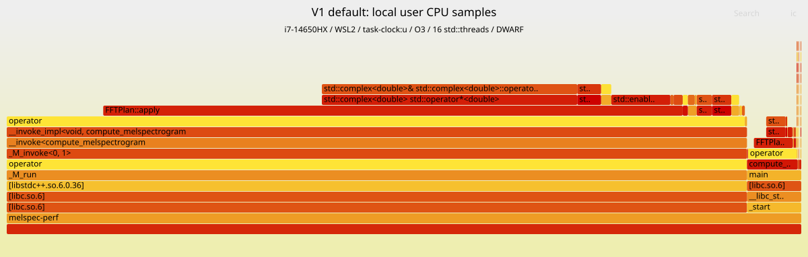
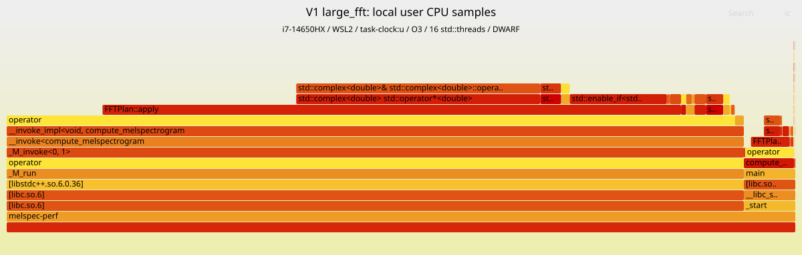

# V1 本地 perf profile 报告

日期：2026-10-30。代码基线：`191225a`（算法提交 `4980121`）。本轮**不改算法与正式构建**，
只增加独立的采样脚本、分析记录和火焰图。AI 辅助：OpenCode / GPT-6.1 Sol。

## 1. 结论

1. **FFT 仍是首要热点**：default / large_fft 的 FFT 分别占用户态 CPU 样本 **77.83% / 78.25%**；
   加上实数谱恢复/功率谱后合计 **91.42% / 90.05%**。
2. **位反转值得单独优化**：`src/melspec.cpp:54–55` 的索引、判断及交换约占总样本
   **12.13% / 17.65%**。可先试验将位反转融合进加窗打包，而不是直接重写整个 FFT。
3. 编译器证据支持 SIMD 优化方向：蝶形内循环与功率谱恢复未实现跨迭代循环向量化，
   而加窗打包和稀疏 Mel 内积已使用 AVX2。不是“代码完全没有 SIMD”，也不是“线程库占用 93%”。
4. 以上是 **WSL/i7 的用户态 CPU 分布**，不是集群 wall-time 占比。没有 PMU 数据，
   **不能据此声称 cache miss、IPC、分支预测失败或内存带宽已被测量**。

## 2. 火焰图

- [default 火焰图：8192 点 FFT](default.svg)
- [large_fft 火焰图：16384 点 FFT](large_fft.svg)





用浏览器直接打开 SVG 可交互查看：点击方块放大、Reset Zoom 还原、Search 搜索
`FFTPlan::apply`、`std::swap` 或 `operator*`。GitHub 的静态预览不一定执行交互脚本。
图的**横轴不是时间线**，宽度是该调用路径覆盖的样本数；高度是栈深，不是耗时。
所有线程合并显示，同一函数在主线程与工作线程中可能出现两次，比较时要合并两条分支。

## 3. 环境与测量方法

| 项目 | 实测状态 |
|---|---|
| 系统 | Arch Linux / WSL2，内核 `6.6.87.2-microsoft-standard-WSL2` |
| CPU | i7-14650HX，WSL 暴露 24 个逻辑 CPU，cpuset `0-23`；AVX2/FMA，无 AVX-512 |
| 内存 | 15 GiB RAM + 4 GiB swap；开始时 swap 使用量为 0 |
| 工具 | GCC 16.2.1，perf 7.3-1，`perf_event_paranoid=2` |
| 诊断编译 | `-std=c++17 -O3 -march=native -pthread -g`，未关闭内联、未使用 `-pg` |
| 输入 | 官方 PCM 本地副本，24,634,880 个样本；全量 default / large_fft |
| 并行 | 保留 V1 的 16 个 `std::thread`；两组采样均观察到 16 个 TID |
| 采样 | `task-clock:u`，请求 499 Hz，继承子线程，DWARF 栈快照 16 KiB |
| FlameGraph | Brendan Gregg FlameGraph，commit `41fee1f99f9276008b7cd112fca19dc3ea84ac32` |

WSL 的硬件事件 `cycles:u`、`instructions:u`、`cache-references:u`、`cache-misses:u`
均返回 `<not supported>`，所以选择可用的软件时钟事件。没有修改权限、内核参数或安装特权工具。
源码哈希与之前的集群 V1 完全一致，详见 [`raw/environment.txt`](raw/environment.txt)。

采样输出也与官方 expected 全量对比：

| 用例 | 输出 float 数 | 最大绝对误差 | `rtol=1e-3, atol=1e-4` |
|---|---:|---:|---|
| default | 49,253,632 | 0.03125 | PASS |
| large_fft | 49,237,248 | 0.125 | PASS |

本次选择两种 FFT 规模作为代表，不重新运行 librosa；V1 原有四组集群验证仍见上一级报告。

## 4. 从函数热点到算法阶段

### 4.1 为什么只看默认函数表会误判

未展开内联的 `perf report --no-children` 显示：

| 归属符号 | default self | large_fft self |
|---|---:|---:|
| 工作线程入口 `std::thread::...::_M_run()` | 93.17% | 93.48% |
| `compute_melspectrogram()` | 6.24% | 6.31% |

**这不是线程创建/调度开销**。`-O3` 把 worker lambda、`FFTPlan::apply`、复数运算等内联进线程入口；
主线程还直接执行 worker(0)，因此同样的计算也会归到 `compute_melspectrogram()`。
本次保留优化，用 DWARF 和 `perf script --inline` 恢复内联栈，没有用 `-fno-inline` 人为改变热点。

同理，inclusive 表中 `FFTPlan::apply` 的 default 两项 **72.93% + 4.90%** 要合并；
不能只取第一项，也不能将调用者与其子函数的 inclusive 百分比相加。
复数乘法栈的总覆盖率为 **36.60% / 34.63%**，但它已经包含在 FFT/恢复阶段内，不是额外开销。

### 4.2 按应用源码位置归并

`scripts/perf_local.py` 从每条展开栈中选取最内层的 `melspec.cpp` 源码行，
**每个样本只计一次**。边界映射和原始计数见 `raw/*/source-summary.json`。

| 互斥阶段 | 源码位置 | default 样本 | default 占比 | large_fft 样本 | large_fft 占比 |
|---|---|---:|---:|---:|---:|
| FFT 位反转循环 | 54–55 | 797 | **12.13%** | 4042 | **17.65%** |
| FFT 蝶形及循环控制 | 52–67 的其余位置/188 | 4319 | **65.71%** | 13882 | **60.61%** |
| 实数谱恢复/功率谱 | 190–199 | 893 | **13.59%** | 2701 | **11.79%** |
| 加窗/奇偶打包 | 184–187 | 262 | 3.99% | 943 | 4.12% |
| 稀疏 Mel 投影 | 202–207 | 263 | 4.00% | 1288 | 5.62% |
| 读取、写出、准备及其他 | 其余 | 39 | 0.59% | 49 | 0.21% |
| **全部** | | **6573** | **100%** | **22905** | **100%** |

两组 `perf report` 均显示 **Total Lost Samples: 0**，折叠栈总计数与上述样本总数一致。
优化后的指令可能合并多个源码操作，因此**行级分布是统计归属，不是精确的逐语句计时**。
FFT 整体占比还与火焰图中包含 `FFTPlan::apply` 的所有路径总宽度交叉核对，结果一致。

位反转循环中，仅 `std::swap` 内联栈约占 **8.06% / 13.14%**；完整循环还包含索引访问、
条件判断和循环控制，所以 12.13% / 17.65% 与 swap 比例不同。这不是两组可以相加的开销。

### 4.3 编译器向量化证据

以相同优化选项额外运行 `-fopt-info-vec-all`，未更改采样二进制。
节选见 [`raw/vectorization-excerpt.txt`](raw/vectorization-excerpt.txt)：

- `melspec.cpp:58` 蝶形内循环：`couldn't vectorize loop / unsupported control flow`。
- `melspec.cpp:194` 功率谱恢复循环：同样未实现循环向量化。
- `melspec.cpp:185` 加窗打包、`:205` 稀疏内积：使用 **32-byte vectors**，即本机 AVX2。
- `:62–63` 蝶形局部基本块仍有 **16-byte SLP**，所以不能写成“FFT 完全没有向量指令”。

该诊断只证明 GCC 16.2 在本地的代码生成；尚未证明集群 GCC 15.2 的具体汇编和收益。
`std::complex` 的控制流/特殊值语义可能妨碍跨蝶形 SIMD，但不应将模板名称本身等同于开销。

## 5. 计时及不能从火焰图得到的结论

先运行独立的 `perf stat -r 3`，没有抓栈。这里是 **perf 给出的三次均值及统计误差项**，
不是官方 benchmark 的三次最小值，也不是此次采样过程的 wall time：

| 用例 | 平均 wall time | 累计用户 CPU 时间（均值） |
|---|---:|---:|
| default | 1.3176 ± 0.0543 s | 13.0098 s |
| large_fft | 3.1926 ± 0.1279 s | 41.5931 s |

不要把这些本地秒数与集群 V1 相除。WSL 调度、共享宿主机、CPU/编译器不同，
而 DWARF 抓栈本身也会引入扰动；原始 `stat.txt` 保留了运行方差。

另外：

- `task-clock:u` 不覆盖内核执行、I/O 等待和线程阻塞。读写样本比例低，**不等于读写 wall time 可忽略**。
  集群阶段计时仍显示读取约 0.18 s、转换写出约 0.22–0.25 s，两者并不矛盾。
- 软件计数中 context-switches/cpu-migrations 为 0，不能据此断言无调度或迁移；
  本报告不使用这些数字推导线程效率。
- 不报告 cache miss / TLB miss、IPC、指令吞吐、内存带宽或 AVX-512 收益。
- 某些系统库栈显示地址/DSO 名称，应用热路径与内联栈可以解析；未为此安装系统 debug 包。
- 集群阶段计时 FFT 约 76–81%、恢复约 13–15%，本地的整体热点方向与之吻合，
  **但分母、硬件和采样方法不同，不能将具体百分比直接替换过去**。

## 6. 下一步优化实验建议

| 优先级 | 独立实验 | 依据与验收 |
|---|---|---|
| 1 | 将位反转融合进加窗打包，随后执行无需再次位反转的蝶形 | 直接针对 12–18% 的用户 CPU 样本；保持 double 和稀疏 Mel 不变，先验证全部边界与四组全量 |
| 2 | 重写蝶形数据布局/基数，跨蝶形 SIMD，而非只在一个复数内部做 SLP | FFT 约占 78%；本地通用/AVX2，集群再测 AVX-512，可用自带 FFT 库作对照 |
| 3 | 向量化实数谱恢复与模平方 | 独立约 12–14%，避免把数值类型和算法同时改掉 |
| 后置 | float32 FFT、进一步优化 Mel、线程数量/绑定扫描 | 精度和平台相关变量单独实验，避免一次改变过多因素 |

融合位反转可能把随机交换变成打包时的散写/索引访问，**并不保证消除全部 12–18% 开销，更不等同于 wall-time 收益**。
这里只提出可验证假设，不实施 V2，也不承诺未测的加速比。

## 7. 复现与文件说明

```bash
git clone --depth 1 https://github.com/brendangregg/FlameGraph.git tmp/tools/FlameGraph
git -C tmp/tools/FlameGraph checkout 41fee1f99f9276008b7cd112fca19dc3ea84ac32
source scripts/env.sh
$PY scripts/perf_local.py --cases default large_fft --out tmp/perf-v1-new
```

若已有工具目录则不用再次 clone；旧 commit 不在浅克隆中时需先 fetch 对应 commit。
输出目录要求不存在，防止覆盖证据。关键采样/渲染命令：

```bash
perf record --no-buildid-cache -e task-clock:u -F 499 --call-graph dwarf,16384 \
  -m 128 -o tmp/perf-v1-new/default/perf.data -- tmp/perf-v1-new/melspec-perf \
  tmp/data/audio.pcm tmp/perf-v1-new/default/output.bin \
  --sr 96000 --n_fft 8192 --hop_length 128 --n_mels 256 --f_min 0 --f_max 22050
perf script --inline -F comm,pid,tid,time,event,ip,sym,dso \
  -i tmp/perf-v1-new/default/perf.data > tmp/perf-v1-new/default/stacks.txt
perl tmp/tools/FlameGraph/stackcollapse-perf.pl tmp/perf-v1-new/default/stacks.txt \
  > tmp/perf-v1-new/default/folded.txt
perl tmp/tools/FlameGraph/flamegraph.pl --countname samples \
  tmp/perf-v1-new/default/folded.txt > tmp/perf-v1-new/default/flamegraph.svg
```

`perf script` 显式省略 `period`，让折叠文件按样本数计数；若保留默认输出中的时钟周期字段，
FlameGraph 会按该字段加权，不能仍将数字标成 samples。

本次实际成功输出目录是 `tmp/perf-v1-r2/`。保留在 `tmp/` 的大文件：诊断二进制、
约 104/363 MB 的 perf.data、原始展开栈和两个约 197 MB 输出；不会提交这些文件。
展示与复核所需的 SVG、折叠栈、源码分组 JSON、函数/行报告、事件探测与环境信息归档在本目录。
FlameGraph 上游：[brendangregg/FlameGraph](https://github.com/brendangregg/FlameGraph)。

失败尝试也保留：首次 `-m 1024` 因锁页额度失败，未产生有效 profile；改成 `-m 128` 后成功，
无需提权。原始报错见 `raw/first-attempt-record.txt`，不能把那次执行当作有效采样。
