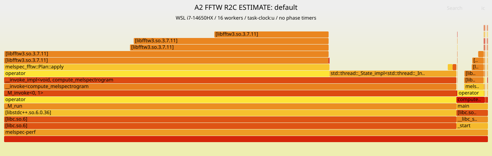

# A2 FFTW 后的新瓶颈与 V3 建议

> 第二轮 float/Wisdom 的未插桩 Release 结果在 [experiments/RESULTS.md](experiments/RESULTS.md)。
> 为按用户要求快速收尾，没有运行该组合的新 profile；本页所有阶段占比仍只代表原 double A2，
> **不能直接套用到 float + PATIENT Wisdom**。诊断工具已支持该路线，但不将未采集数据写成结论。

正式候选：`b4552f3962751b5a02d2aa56798907c5a1c29afc`，R2C + ESTIMATE + double。
主报告：[README.md](README.md)；复现：[REPRODUCE.md](REPRODUCE.md)。
正式计时没有启用插桩；本页的阶段时间/采样时间不作为新成绩。

## 1. 集群阶段 profile（作业 59，hepnode2，16 CPU）

与作业 58 同一候选、同一静态 FFTW 库。另编译 `-DMELSPEC_PROFILE=1`，
main 计时包装只生成在 tmp，不修改 `src/main.cpp`。四组诊断输出再次全部 PASS。

| 用例 | 读取/归一化 s | compute 准备 s | FFT plan s（已含在准备内） | compute 全部 s | 转换/写出 s | 诊断进程 wall s |
|---|---:|---:|---:|---:|---:|---:|
| default | 0.180045 | 0.210458 | 0.002165 | 0.565350 | 0.222535 | 0.997980 |
| small_mels | 0.178623 | 0.055701 | 0.002184 | 0.410502 | 0.071984 | 0.682547 |
| large_fft | 0.176482 | 0.215012 | 0.002389 | 0.933266 | 0.220824 | 1.361345 |
| narrow_band | 0.174815 | 0.213367 | 0.002396 | 0.877677 | 0.237344 | 1.322394 |

准备包括窗口/滤波器、output.resize、每线程 scratch 和规划，**不能与 compute 全部相加**。
调用/退出、释放等还会产生少量未落入表格阶段的成本。

各线程累计的阶段 wall time 比例（不是全进程 wall 占比）：

| 用例 | 加窗/输入拷贝 | FFTW execute | 模平方 | 稀疏 Mel |
|---|---:|---:|---:|---:|
| default | 12.39% | **69.27%** | 6.56% | 11.78% |
| small_mels | 12.09% | **68.33%** | 6.45% | 13.14% |
| large_fft | 12.39% | **69.57%** | 6.14% | 11.90% |
| narrow_band | 13.43% | **75.41%** | 6.66% | 4.50% |

### 如何解读热点迁移

- **FFT 仍是 worker 里的最大计算热点**，并没有转成“Mel 占大头”。
- A1 保留的手工频谱恢复在本地阶段测试占约 25–31%；A2 移除了它，剩余模平方约 5–7%。
  这解释了为什么 A2 稳定胜过仅替换半长 FFT 的 A1。
- Mel 和输入拷贝相对份额上升，不等于它们的绝对时间增加；FFT/恢复变快后分母变小。
- **全进程瓶颈已经不再等于 worker CPU 瓶颈**：default 的读入 + 准备 + 写出约
  `0.180 + 0.210 + 0.223 = 0.613 s`，占该次诊断进程约 **61%**；large_fft 约 **45%**。
  继续只看“FFT 占约 70%”会严重高估可获得的总加速比。
- ESTIMATE 的 plan 仅约 2 ms，不是当前启动瓶颈。default 与 small_mels 准备时间差约 0.155 s，
  两者 FFT 参数相同、输出 double 矩阵相差约 296 MB，提示大输出初始化值得单独验证，
  **但现有计时没有将 output.resize 与滤波器准备完全分开，不能断言所有差值都来自 memset**。
- 峰值 RSS：default 784988 KiB、large_fft 789284 KiB，约 767–771 MiB；无 swap/major fault。
  输出 double、输入 double、写出 float32 的固定存储成本仍在，不宣称 V2 降低了 V1 的整体内存量级。
- `time -v` 的平均 CPU 利用率约 617–881%，不能直接解释为线程效率差：
  程序里读入/分配/写出的串行时间占比已显著增加，采样/计时覆盖 16 个工作分区。

## 2. ESTIMATE / MEASURE：规划和执行必须分开看

正式五版本对照已经表明：**冷启动 MEASURE 输给 ESTIMATE**。
A1 MEASURE 在 default/small_mels 甚至比 V1 慢，原始结果保留，不为使用 FFTW 而选择它。

作业 64 在同一计算节点额外用独立小工具实测，**每组先 forget_wisdom**，打印实际 plan。
它是单线程、5000 次输入刷新 + FFT 的微基准，不是 16-worker 进程成绩，不包含 Mel/读写。

| 路线 | n_fft | EST 规划 s | MEASURE 规划 s | EST copy+execute μs | MEASURE copy+execute μs |
|---|---:|---:|---:|---:|---:|
| 半长 C2C | 8192 | 0.000155 | 0.558106 | 21.071 | 15.386 |
| 半长 C2C | 16384 | 0.000190 | 0.823334 | 46.523 | 32.670 |
| 原生 R2C | 8192 | 0.001642 | 0.453453 | 22.333 | 16.223 |
| 原生 R2C | 16384 | 0.001925 | 0.664688 | 46.126 | 34.415 |

结论：MEASURE 确实找到更快的微内核选择，但需要约 0.45–0.82 s 规划，本题一进程一段输入，
冷规划开销抵消收益；不能把单线程每帧节省直接乘到 16 核的进程上。
该微基准的 C2C 不包含手工恢复，因此不能据它比较完整 A1/A2。

plan 文本确认 ESTIMATE R2C 实际包含 AVX2 real 前端和 `t3fv_32_avx512` /
`n1fv_128_avx512`；MEASURE 选择不同分解，并混用 AVX/AVX2/AVX-512 codelets。
这不是“开 AVX-512 就一定最快”的问题。所有缓冲的 FFTW alignment class 为 0。
原文见 `raw/cluster/fftw-64.out`。

## 3. 本地 perf 与火焰图（正式验证之后）

另建未插桩的 `-O3 -march=native -pthread -g` 诊断程序，保留 16 worker，
链接本地系统 FFTW 3.3.11。WSL/i7-14650HX，AVX2/FMA，无 AVX-512；不修改共享 Python 环境。
`task-clock:u`、199 Hz、DWARF 16 KiB、ring 256 pages；两组全量输出 PASS，**丢样均为 0**。

| 用例 | 有效样本数 | 含 `melspec_fftw::Plan::apply` 的总宽度 |
|---|---:|---:|
| default | 1795 | **71.25%**（1279 样本） |
| large_fft | 5154 | **71.73%**（3697 样本） |

- [default 火焰图](perf/default/flamegraph.svg)
- [large_fft 火焰图](perf/large_fft/flamegraph.svg)

手写 `FFTPlan::apply` / 位反转交换 / 共轭恢复栈已消失，工作转入 FFTW；
**不代表 FFTW 内部完全没有重排**。系统 FFTW 的内部局部符号被剥离，所以部分显示为
`[libfftw3.so.3.7.11]` 或地址，只能可靠归到库/调用者，不能凭地址编造具体 codelet 热点。
同一调用者在 worker 和主线程分支都出现，统计只按每条折叠栈计一次，不叠加父子 inclusive 比例。

本地 CPU 结果与集群 worker 阶段方向吻合，但具体比例不能互换；本地没有硬件 PMU，
没有报告 IPC/cache miss/TLB miss 或 AVX-512 性能。用户态采样不覆盖内核/I/O 等待，不能因为
读取/写出栈窄就否认集群约 0.4 s 的读写 wall 成本。

失败采样保留：首次 499 Hz、128-page ring，default 丢失 1422 个样本，**不用于定量结论**。
降低频率并扩大合法锁页额度内的 ring 后重测成功；脚本已加入丢样检查，避免将坏图当有效 profile。
上游 FlameGraph commit 与系统信息在 `perf/environment.txt`；大 `.data` / 展开栈留在 tmp，不提交 Git。

## 4. 可直接指导 V3 的建议（本轮不实施）

1. **优先检验 FFTW wisdom 的规划/执行解耦**：probe 证明 MEASURE 内核有约 25–30% 的
   单线程 copy+execute 潜力。可在目标机上按 FFT 参数、精度和 CPU/库版本离线生成 wisdom，
   运行时用智慧计划快速导入；需要明确计入生成/导入成本、授权与可移植性，任何失配都回退 ESTIMATE。
   它只能依赖算法/机器参数，不能包含 PCM/expected 特征。仍需 16 worker 全流程复测，不能承诺同等总收益。
2. **控制规模的 batched R2C / plan-many 实验**：对连续小批帧做加窗 + FFT + Mel，
   尝试减少每帧调用和改善 FFT SIMD/数据布局。严格限制中间矩阵，不回到物化全量功率谱。
   本轮为尽快交付正式候选未开展 batched，不伪造结果。
3. **细分准备阶段**：分别计时 output.resize、滤波器建立、对齐 scratch/plan，
   验证是否主要是大输出初始化/page fault。只用合规的 C++ 对象生命周期和接口，
   不通过改 vector 内部指针/size、写越界 storage 等 UB 来省初始化。
4. **关注 Mel 输出布局而非稠密 GEMM**：worker 中稀疏 Mel 约 12%，可小批量改善行主序写入；
   narrow_band 仅 4.5%，不能用一个用例的局部改善宣称普遍收益。
5. `src/main.cpp` 不可修改，当前读入/归一化与 double→float 写出应作为受约束的固定成本。
   **不以违规修改 main 来突破计时下界**；所有候选继续同节点 V1/A2 对照并跑完整官方验证。

推荐保留 **A2 ESTIMATE 为 V3 对照基线**，冷 MEASURE 与 A1 的失败/较慢数据用于决策，不删除。
